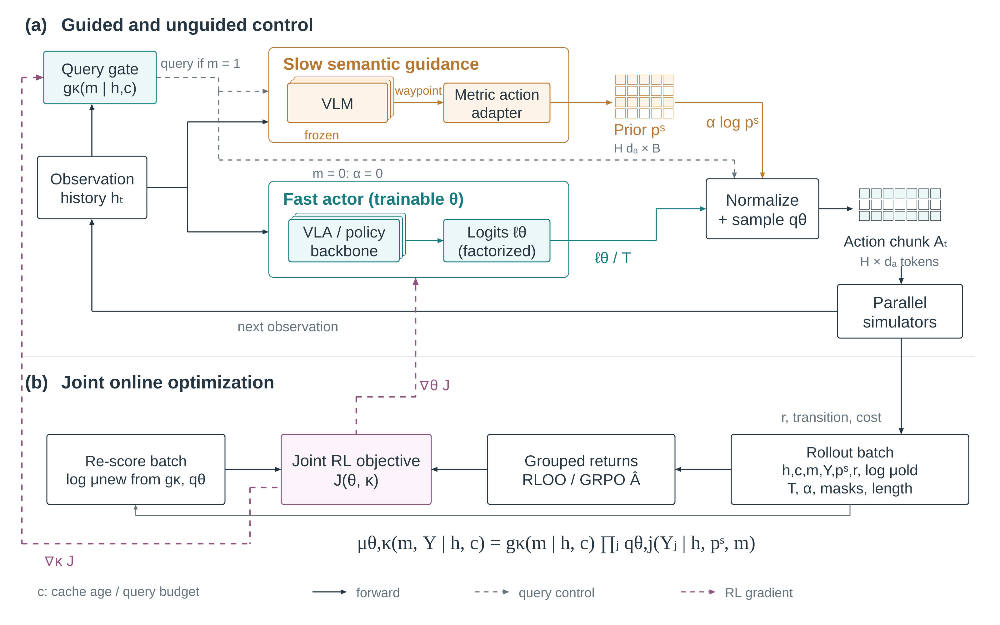
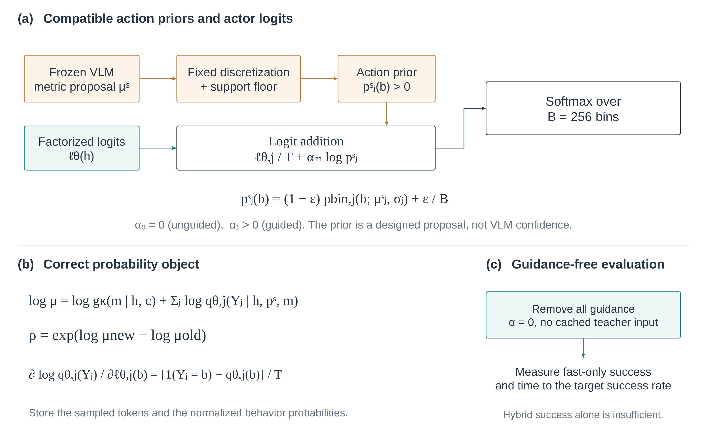
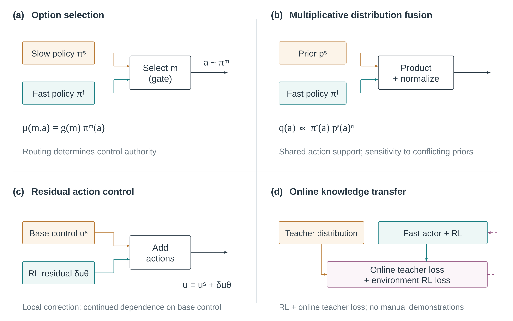

# Reason2Reflex

**从慢速理解与探索，到快速熟练操作。**

这是 Kannospark 的机器人学习研究档案：在一个明确限定的操作场景中，用仿真在线强化学习，让 VLM 的语义理解与探索指导逐渐转化为无需频繁思考的快速闭环策略，并研究 sim-to-real 的高可靠执行。

名称 **Reason2Reflex** 表示 *Reasoning → Reflex*。人初次使用电脑、逐渐学会屏幕反馈与手部运动映射的过程，是这个想法的动机。

> **状态：研究设计与讨论记录，尚未实现训练算法，尚无本方案的机器人实验结果。** “100% 成功率”是研究发起者的原始愿景；有限次全部成功、统计可靠性下界和绝对保证在本文档中分别讨论。

## 当前研究主线

- **任务范围**：固定场景；用户举例包括 pick-and-place 和 RoboDojo 类长程操作，具体任务及先后顺序尚未选定。暂不以跨场景泛化为主要目标。
- **训练基线**：[SimpleVLA-RL](https://arxiv.org/abs/2509.09674) 式并行仿真、在线交互和环境奖励。它的任务 SFT 初始化与“零任务示范冷启动”需要分开对待。
- **慢系统**：VLM 理解当前场景，给出子目标、waypoint 或直接末端运动建议，帮助早期探索及不熟悉状态的决策。
- **快系统**：VLA 或其他可训练动作策略，通过交互形成连贯动作，减少慢模型调用。
- **关键问题**：怎样让指导真正进入快策略的学习，而不仅是把控制权交给一个更强的教师？
- **可选扩展**：动作条件世界模型，用于短程预测、候选动作评估与训练辅助。先验证融合机制，再决定是否引入大型 WAM。

用户明确希望避免“先人工采集任务演示，再离线训练”成为必经流程。“无人工任务示范”“零任务 SFT”“只用 RL 损失”“全随机初始化”仍须逐项定义。在线教师辅助损失是否允许，尚未定案。

当前记录三条候选路线，均需实验比较：

| 候选 | 作用 | 关键局限 |
|---|---|---|
| Hard gate / options 联合 RL | 在慢理解与快技能之间分配控制权和调用预算 | 独立慢分支接管，不会自动训练快动作头 |
| RL + 在线知识转移 | 在同一交互循环中把教师建议写入学生 | 无人工预采数据，但包含额外教师损失 |
| Guided product-of-experts | 用慢建议的概率先验改变快策略采样分布，再用实际行为概率做 RL | 助手提出的未验证方案；有饱和、依赖及零学习信号风险 |

## 阅读顺序

1. [原始想法与讨论演进](docs/01-idea-and-evolution.md)：保留研究动机、用户的三个技术问题与后续澄清。
2. [当前设想与候选架构](docs/02-current-design.md)：模块、接口、记忆、规模建议及可选 WAM。
3. [训练目标与概率细节](docs/03-training-objectives.md)：前向分布、联合 likelihood、在线 RL 更新、梯度边界。
4. [实验计划与开放问题](docs/04-experiments-and-open-questions.md)：公平对照、fast-only 验证、失败分析与实物可靠性评估。
5. [相关工作与研究启发](docs/05-related-work.md)：双系统、技能融合、在线知识转移、世界模型与 sim-to-real；附 [BibTeX](references.bib)。
6. [决策、状态与未决事项](docs/06-decisions-and-status.md)：区分用户明确意图、助手建议、已撤回解释和待确认选择。
7. [文件清单与来源](docs/07-artifacts-and-provenance.md)：全部图稿、研究备忘及历史版本的边界。

## 修订图稿（v2）

三张图用于表达候选方案，不代表用户已最终选定 guided PoE，也不代表方法已经验证。图形质量尚未获用户最终验收。

[可编辑 PowerPoint](figures/dual_system_online_rl_paper_figures.pptx) · [全部 PNG](figures/paper_figures_png.zip)

**图 1：在线训练闭环与部署路径**

**图 2：指导分布、实际采样与梯度路径**

**图 3：控制权、分布融合、残差和在线知识转移**

## 原始记录与历史材料

[研究对话原文](records/discussion.zh-CN.md)及[结构化消息记录](records/discussion.raw.json)保存本聊天两轮已完成研究讨论中的用户消息和助手最终回答，保留早期解释及纠偏。原回答里的应用引用和本地下载地址属于当时的显示格式；仓库内文件以本 README 的链接为准。

[研究备忘](research/README.md)保留各专题分析。[首版 21 页 PPT 与图稿](archive/v1/README.md)已归档：用户指出首版主图不符合论文展示要求；其中训练主线也先于 SimpleVLA-RL 澄清。阅读当前方案请优先看 docs/ 和 v2 图。

本仓库不包含机器人训练代码、权重、训练数据或实验结果。scripts/ 仅包含档案检查工具；archive/authoring-source/ 是原始图稿生成脚本快照，需要原制作环境。

研究发起与核心构想：**Kannospark**。资料查找、批判性分析、候选数学设计及图稿整理由 AI 助手协助完成。归档日期：2026-11-11。
